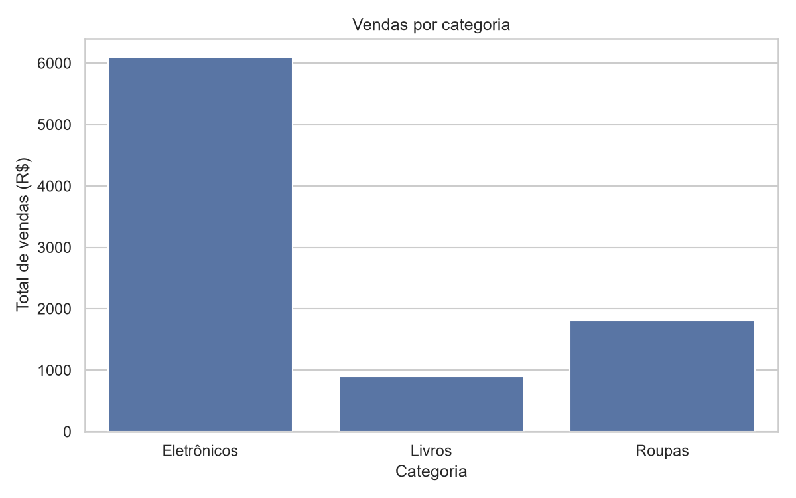
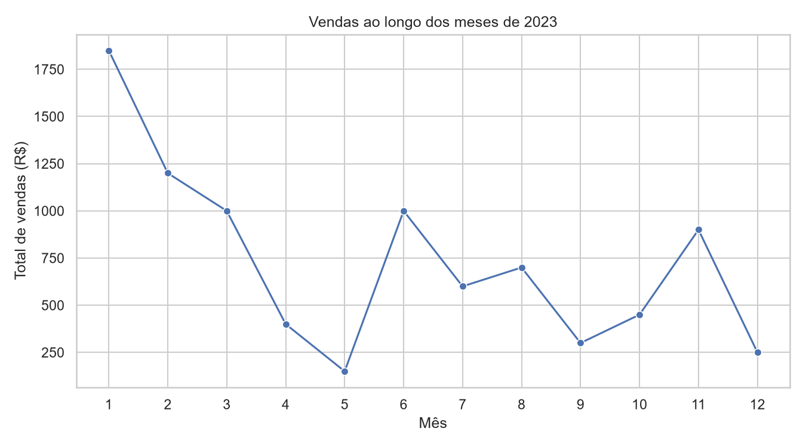

# Análise de vendas com Python

Projeto acadêmico de Nádia Cristina de Jesus, desenvolvido na graduação em Ciência de Dados da Anhanguera, para praticar organização, exploração e visualização de dados.

## Objetivo

Analisar vendas fictícias de 2023 para responder:

- Qual categoria apresenta o maior valor de vendas?
- Como os valores se distribuem ao longo dos meses?
- Existem valores ausentes na base?

## Tecnologias

Python, SQLite, pandas, Matplotlib e Seaborn.

## Como executar

Com Python 3.10 ou superior instalado, abra um terminal na pasta do projeto e execute:

```sh
python -m pip install -r requirements.txt
python analise_vendas.py
```

O programa imprime os resumos e salva dois gráficos e três arquivos CSV na pasta `resultados`. O banco SQLite é criado em memória a cada execução, sem duplicar os registros e sem exigir arquivos externos.

## Dados e resultados

A base contém 14 vendas simuladas, nas categorias Eletrônicos, Roupas e Livros. Os dados estão definidos no próprio código e são exportados para `resultados/vendas.csv`.

| Categoria | Total de vendas |
| --- | ---: |
| Eletrônicos | R$ 6.100,00 |
| Roupas | R$ 1.800,00 |
| Livros | R$ 900,00 |
| **Total** | **R$ 8.800,00** |

Janeiro tem o maior valor observado: R$ 1.850,00. Nenhum dos 14 registros possui campos ausentes.





## Limitações

Esta é uma base fictícia, pequena e referente a apenas um ano. As diferenças entre os meses descrevem os dados do exercício; não permitem comprovar sazonalidade, padrões de consumo ou orientar decisões comerciais reais. Os valores representam vendas, não lucro.

## Origem e recuperação do código

O código foi recuperado da seção “Código completo”, páginas 4 a 8 do relatório acadêmico `AnalisedeDados.pdf`. Os 14 registros e os agrupamentos originais foram preservados.

Na preparação para o GitHub, com auxílio de IA, foram feitas adaptações: organização em uma função principal, banco em memória para evitar inserções duplicadas, fechamento da conexão, exportação dos resultados e gravação dos gráficos em arquivos no lugar de janelas interativas. A versão extraída antes dessas adaptações está em `referencia/codigo_extraido_pdf.py`.

## Aprendizados praticados

- Criação de tabela e consultas em SQLite.
- Conversão de datas e exploração com pandas.
- Agrupamento e soma por categoria e mês.
- Visualização com gráficos de barras e de linha.

## Próximos passos

- Permitir a leitura de um CSV fornecido pelo usuário.
- Validar datas e valores antes da análise.
- Explorar uma base maior e documentar sua origem.

## Verificação da recuperação

Os 14 registros foram comparados com o código extraído do PDF. A criação da tabela, a consulta SQLite e os totais foram conferidos com pandas. O programa foi executado com sucesso em Python 3.12, com geração dos três CSVs e dos dois gráficos. Os resultados confirmam 14 vendas, total de R$ 8.800,00 e ausência de valores nulos. Os dois gráficos foram inspecionados visualmente.
